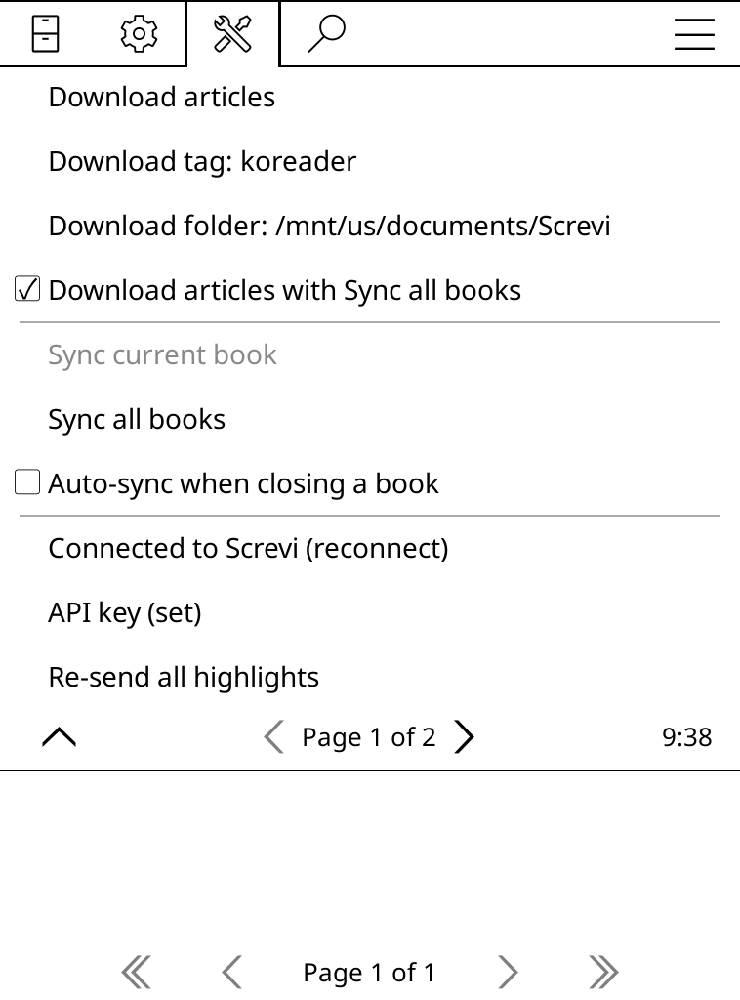
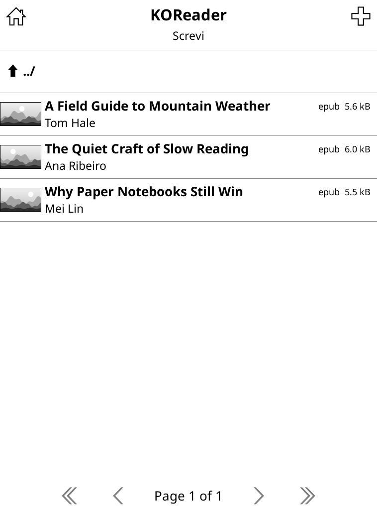
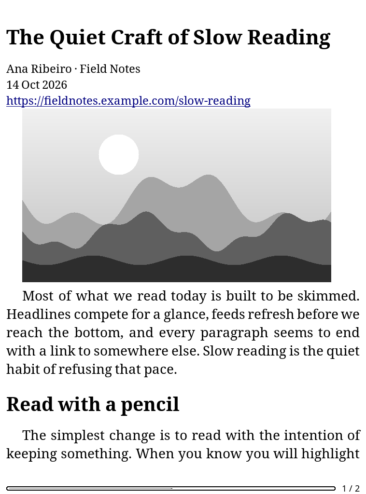
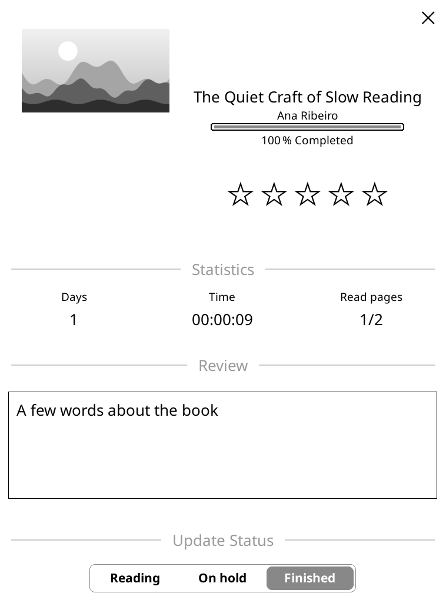

# Screvi for KOReader

Read Screvi articles and sync your [KOReader](https://koreader.rocks) highlights and notes to [Screvi](https://screvi.com), on Kindle, Kobo, PocketBook, Android or desktop.

- Connect with a short code. No typing an API key on an e-ink keyboard.
- Sends each highlight's text, note, page, chapter and date, with the book's title, authors and ISBN.
- Only sends what's new. Screvi also skips highlights it already has, so re-sending is always safe.
- Optional auto-sync when you close a book (only if Wi-Fi is already on).
- Also shows up in KOReader's built-in Export highlights menu.

## Install

1. Download `screvi-koreader.zip` from the [latest release](https://github.com/screvi/screvi-koreader-plugin/releases/latest) and unzip it. You get a folder called `screvi.koplugin`.
2. Connect your e-reader by USB and copy that folder into KOReader's `plugins` folder:

   | Device | Folder |
   |---|---|
   | Kindle | `koreader/plugins/` |
   | Kobo | `.adds/koreader/plugins/` |
   | PocketBook | `applications/koreader/plugins/` |
   | Android | `koreader/plugins/` |
   | Linux (AppImage) | `~/.config/koreader/plugins/` |
   | macOS | `~/Library/Application Support/koreader/plugins/` |

3. Restart KOReader.

## Connect

1. In KOReader, open the top menu → **Tools** → **Screvi** → **Connect to Screvi**.
2. KOReader shows a code like `K7F2-9QXD` and a QR code. Scan it with your phone, or open [app.screvi.com/pair](https://app.screvi.com/pair) and type the code.
3. Approve it on Screvi. KOReader picks up its key within a few seconds.

Each device gets its own key, listed in Screvi under **Settings → API**. Revoke it there to disconnect that device. You can also paste a key by hand under **Screvi → API key**.

## Sync

- **Sync current book** sends new highlights from the open book.
- **Sync all books** sends new highlights from every book in your reading history.
- **Auto-sync when closing a book** sends new highlights when you close a book, if Wi-Fi is already on. It never turns Wi-Fi on; anything it skips goes out with the next sync.
- **Re-send all highlights** forgets book highlight history. Screvi skips book highlights it already has. Article highlight history is kept.

The sync and download actions are also in KOReader's gesture and shortcut manager, under "Screvi".

### Export highlights

The plugin also adds **Screvi** to KOReader's built-in **Export highlights** menu (Tools → Export highlights → Choose formats and services), next to the other export targets. It uses the same connection, so there is nothing else to set up.

## Articles

Tag articles **koreader** in Screvi. In KOReader, choose **Tools → Screvi → Download articles**. Articles that are still being parsed wait for the next download.

| Download | Your articles | Read | Finish |
|---|---|---|---|
|  |  |  |  |

Articles are saved as EPUBs in **Screvi** inside your KOReader home folder. Images are included when they can be downloaded. Change **Download tag** or **Download folder** in the Screvi menu. Existing files are skipped.

**Sync all books** also downloads articles by default. Turn off **Download articles with Sync all books** to download only when you choose to.

Mark an article's book status **Finished** in KOReader. On the next download, the plugin sends its highlights, archives it on Screvi, then removes its local EPUB and sidecar. With auto-sync enabled and Wi-Fi already on, this also happens when you close the article. An open article stays on disk until it closes or a later download runs.

If you remove the current download tag or archive an article on Screvi, the next download removes the plugin's local copy after sending any new highlights. Changing the download tag keeps earlier downloads until you finish them or switch back. If an article is deleted on Screvi, the plugin stops tracking and retrying it, and keeps its EPUB and notes on your device. Copies the plugin did not create are left alone.

Article highlights link to the original Screvi article. Use **Sync current book**, **Sync all books** or auto-sync to send them. The built-in **Export highlights → Screvi** target skips article files because it does not share the plugin's sync history.

Downloading needs a key with **read** access. Sending highlights and archiving need **write** access too. If your device's key lacks access, reconnect with **Connect to Screvi**, or paste a key with read and write access from **app.screvi.com → Settings → API**.

## How it works

- Reads highlights from KOReader's annotations (2024.05 and later) and from the older `highlight`/`bookmarks` sidecar format. Page bookmarks are not highlights and are left out.
- Sends book highlights to Screvi's import API in batches of up to 500. Article highlights use the public API in batches of up to 100.
- Remembers what it has sent in `screvi_settings.lua` in KOReader's settings folder. A highlight counts as sent only after Screvi accepts it.
- Editing a book highlight's note re-sends it, but Screvi keeps the first version: it matches book highlights by book and text. Before sending article highlights, the plugin fetches the article's existing highlights and compares text and notes with trimmed, collapsed whitespace. Matches are marked synced without another bulk upload. Edited notes are sent as new highlights so the edits are preserved, including retries after a timed-out response.

## Development

The tests run the real `main.lua` against stubbed KOReader modules:

```sh
brew install luajit   # or your package manager
luajit spec/run.lua
```

`./build-zip.sh` runs the tests and writes `dist/screvi-koreader.zip`, the asset attached to each release.

```
_meta.lua            # Plugin metadata
main.lua             # Plugin logic
screvi_exporter.lua  # Screvi target for the Export highlights menu
screvi_articles.lua  # Article downloads, highlights and archive sync
screvi_epub.lua      # EPUB packaging with bundled images
spec/run.lua         # Test harness
```

The plugin files sit at the repository root, so the repository can be used directly as a `screvi.koplugin` folder (as in [koreader/contrib](https://github.com/koreader/contrib)).

## License

[AGPL-3.0](LICENSE), the same license as KOReader.
